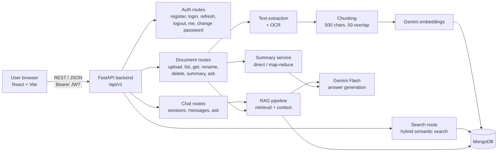

<div align="center">


# DocuMind AI

**AI-powered document intelligence workspace: upload documents, search them by meaning, and chat with them.**

Developed by **Raja Sundaram R S** · Hexaware Internship Project


</div>

---

## Table of contents

1. [Overview](#overview)
2. [Features](#features)
3. [Tech stack](#tech-stack)
4. [Architecture](#architecture)
5. [How it works](#how-it-works)
6. [Project structure](#project-structure)
7. [Getting started](#getting-started)
8. [Deployment](#deployment)
9. [Configuration](#configuration)
10. [API reference](#api-reference)
11. [Frontend guide](#frontend-guide)
12. [Security](#security)
13. [Testing](#testing)
14. [Limitations and future work](#limitations-and-future-work)
15. [Credits](#credits)

---

## Overview

DocuMind AI turns a pile of documents into a searchable, conversational knowledge base.

A user signs up, uploads files (PDF, Word, Excel, PowerPoint, CSV, text or images), and DocuMind AI:

- **extracts the text**, including OCR for scanned PDFs and images,
- **splits it into chunks and creates embeddings** with Google Gemini,
- lets the user **search by meaning** (semantic + keyword hybrid search),
- **answers questions** in a ChatGPT-style chat grounded only in the user's own documents, with sources,
- **summarises** whole documents into a summary and key points.

Every document, chunk, chat and search is scoped to the signed-in user.

---

## Features

### Documents
- Upload **PDF, DOCX, TXT, CSV, XLSX, PPTX, PNG, JPG/JPEG** (up to 10 MB each), by button or drag and drop.
- File-signature validation, safe filenames and per-user storage.
- Automatic **OCR** for scanned PDFs and images (Tesseract).
- Per-document statistics: pages, words, characters, chunks, processing type.
- **AI summary with key points**, using a multi-stage map-reduce summary for large documents.
- Rename (file type is preserved) and delete (file, chunks and record).

### AI search
- **Hybrid semantic search**: 75% embedding similarity + 25% keyword relevance.
- Contextual neighbour boosting, so passages next to strong matches rank higher.
- Filter by document, choose 5 / 10 / 20 results, and see the match score with a meaning/keyword breakdown.
- **Ask AI**: a written answer from all documents with its sources.

### AI chat (chatbot experience)
- Conversations with history, grouped by Today / Yesterday / Previous 7 days / Older, plus search.
- A chat can be linked to one document or ask across all documents.
- **Whole-document context** for small documents and broad questions ("summarize", "key points", "explain this pdf"), so answers are complete and accurate.
- ChatGPT-style answers: headings, lists, tables and code blocks with copy buttons, revealed word by word.
- Suggested prompts, typing indicator, copy answer, save a note without asking the AI, rename and delete chats.

### Accounts and security
- Register / sign in with strong-password rules.
- **JWT access tokens (30 min) + rotating refresh tokens (7 days)** stored hashed in MongoDB.
- Change password (signs out all devices), sign out (revokes the refresh token).
- Rate limiting, security headers, CORS and safe error handling.

### Interface
- Responsive React app: desktop sidebar, tablet layout, and a **phone app shell** with sticky header and bottom tab bar.
- Brand theme taken from the DocuMind AI logo (blue to violet gradient), sharp-edged design, Inter typography.
- Custom dropdowns, upload progress card, loading screen, empty states and keyboard support.

---

## Tech stack

| Layer | Technology |
|---|---|
| Frontend | React 19, Vite 8, plain CSS (no UI framework), Inter font |
| Backend | Python 3.11+, FastAPI, Uvicorn, Pydantic v2, pydantic-settings |
| Database | MongoDB (PyMongo) with indexes on users, documents, chunks, chats and tokens |
| AI | Google Gemini (`google-genai`): `gemini-embedding-2` for embeddings, Gemini Flash models for answers and summaries |
| Extraction | pypdf, python-docx, openpyxl, python-pptx, CSV reader |
| OCR | Tesseract (`pytesseract`), Poppler (`pdf2image`), Pillow |
| Auth | PyJWT (HS256), pwdlib with Argon2 password hashing |
| Protection | slowapi rate limiting, custom security-headers middleware, CORS |
| Testing | pytest (63 tests) |

---

## Architecture



---

## How it works

### 1. Upload pipeline

1. **Validate**: the extension must be supported, the size at most 10 MB, and the file signature must match the type (`%PDF-`, `PK` zip for Office files, PNG/JPEG magic bytes).
2. **Store**: the file is saved as `uploads/<document_id>.<ext>` and a `documents` record is created with status `processing`.
3. **Extract text** per page or sheet or slide. Scanned PDFs and images go through OCR.
4. **Chunk** the text into 500-character chunks with 50-character overlap, keeping page numbers.
5. **Embed** each chunk with `gemini-embedding-2` and save it to `document_chunks`.
6. **Finish**: statistics are saved and the status becomes `completed` (or `failed` with a reason).

### 2. Hybrid search

```
final score = 0.75 × semantic (cosine similarity of embeddings)
            + 0.25 × keyword  (overlap of meaningful words)
            + contextual neighbour boost (up to +0.08)
```

Results below a minimum semantic score are dropped. Search uses MongoDB Atlas vector search when `VECTOR_SEARCH_ENABLED=true`, otherwise a local similarity fallback.

### 3. Question answering (RAG)

1. Retrieve the best-matching chunks for the question (optionally within one document).
2. **Whole-document mode**: for broad questions, or when the documents fit in about 30,000 characters, the full text is used in page order. Very large documents are sampled evenly from start to end.
3. Otherwise build context from up to 4 anchor chunks plus intelligent neighbours (max 12 chunks).
4. Add recent conversation history (last 10 messages) for follow-up questions.
5. Gemini answers with strict grounding rules: only the document context, no outside knowledge, and a clear "I couldn't find that information in your documents." when needed. It is formatted in Markdown.
6. The question, the answer and the sources are returned. Chat messages are saved to `chat_messages`.

### 4. Summaries

Small documents are summarised directly. Large documents use **map-reduce**: chunks are summarised in batches of 5, then combined into a final summary with key points.

---

## Project structure

```
documind-ai/
├── README.md                     ← you are here
├── .gitignore
├── render.yaml                   Render blueprint (backend deployment)
│
├── backend/                      FastAPI application
│   ├── app/
│   │   ├── main.py               App setup: docs tags, middleware, CORS, routers
│   │   ├── core/
│   │   │   ├── config.py         Settings loaded from .env
│   │   │   ├── database.py       MongoDB connection + all indexes
│   │   │   ├── security.py       Password hashing, JWT create/verify
│   │   │   ├── security_headers.py  Security headers middleware
│   │   │   ├── rate_limiter.py   slowapi limiter
│   │   │   └── error_handlers.py Safe 500 handler (no internals leaked)
│   │   ├── routes/
│   │   │   ├── health.py         GET /health
│   │   │   ├── auth.py           Register, login, refresh, logout, me, change password
│   │   │   ├── documents.py      Upload, list, get, rename, delete, summary, ask
│   │   │   ├── search.py         Hybrid semantic search
│   │   │   └── chats.py          Chat sessions, messages, ask in chat
│   │   ├── schemas/              Pydantic request/response models
│   │   │   ├── user.py · document.py · chat.py · health.py
│   │   └── services/
│   │       ├── file_extraction_service.py   Text from every supported file type
│   │       ├── pdf_service.py · ocr_service.py
│   │       ├── chunk_service.py              Chunking + embedding storage
│   │       ├── embedding_service.py          Gemini embeddings
│   │       ├── search_service.py             Hybrid scoring + neighbours
│   │       ├── vector_search_service.py      Optional Atlas vector search
│   │       ├── rag_service.py                Retrieval + whole-document context
│   │       ├── chat_rag_service.py           Prompting + conversational answers
│   │       ├── chat_service.py               Chat sessions and messages (CRUD)
│   │       ├── document_service.py           Document records (CRUD)
│   │       ├── document_intelligence_service.py  Summaries
│   │       ├── large_document_summary_service.py Map-reduce summaries
│   │       ├── gemini_service.py             Gemini client + model fallback
│   │       └── refresh_token_service.py      Hashed refresh-token store
│   ├── tests/                    pytest suite (auth, security, indexes, search, RAG…)
│   ├── uploads/                  Uploaded files (git-ignored)
│   ├── requirements.txt
│   ├── Dockerfile                Container with Tesseract + Poppler for OCR
│   ├── .env.example              Copy to .env
│   └── pytest.ini
│
└── frontend/                     React + Vite application
    ├── index.html
    ├── public/favicon.png
    └── src/
        ├── main.jsx              Mounts the app
        ├── App.jsx               Auth pages, session restore, loading screen
        ├── App.css               Auth pages, logo lockup, credits, loading screen
        ├── api.js                API client: tokens, auto-refresh, every endpoint
        ├── assets/               Logo (light / dark)
        ├── styles/Dashboard.css  Workspace, chat, responsive app shell
        └── components/
            ├── Dashboard.jsx     Workspace shell: sidebar, top bar, pages, uploads
            ├── Overview.jsx      Dashboard home: stats, Ask AI, recent activity
            ├── DocumentTable.jsx · DocumentDetails.jsx · DocumentBadges.jsx
            ├── SearchView.jsx · SourceList.jsx
            ├── ChatView.jsx      Chatbot: history, conversation, composer
            ├── Markdown.jsx      Safe Markdown renderer for AI answers
            ├── AccountView.jsx   Profile, change password, sign out
            ├── Select.jsx        Custom dropdown
            ├── Icons.jsx         SVG icon set (with brand gradient)
            └── Credits.jsx       "Developed by" credits
```

---

## Getting started

### Prerequisites

| Tool | Version | Notes |
|---|---|---|
| Python | 3.11 or newer | Developed on 3.14 |
| Node.js | 20.19+ or 22.12+ | Required by Vite 8 |
| MongoDB | Community 6+ (local) or Atlas | Default URL `mongodb://127.0.0.1:27017` |
| Tesseract OCR | any recent | For scanned PDFs and images. macOS: `brew install tesseract` |
| Poppler | any recent | Converts PDF pages to images for OCR. macOS: `brew install poppler` |
| Gemini API key | | Free key from [Google AI Studio](https://aistudio.google.com/apikey) |

### 1. Clone

```bash
git clone https://github.com/raja-oss-official/documind-ai.git
cd documind-ai
```

### 2. Backend

```bash
cd backend
python3 -m venv .venv
source .venv/bin/activate          # Windows: .venv\Scripts\activate
pip install -r requirements.txt

cp .env.example .env               # then edit .env (JWT secret + Gemini key)

uvicorn app.main:app --reload      # http://127.0.0.1:8000
```

- Swagger UI: http://127.0.0.1:8000/docs
- ReDoc: http://127.0.0.1:8000/redoc

### 3. Frontend

```bash
cd frontend
npm install
npm run dev                        # http://localhost:5173
```

Open http://localhost:5173, create an account, and upload your first document.

> The backend allows CORS from `http://localhost:5173` and `http://127.0.0.1:5173`.
> If you serve the frontend from another address, add it in `backend/app/main.py`.

### Production build

```bash
cd frontend
npm run build                      # output in frontend/dist
```

---

## Deployment

| Part | Platform | Notes |
|---|---|---|
| Database | **MongoDB Atlas** (free M0) | Indexes are created automatically when the backend starts |
| Backend | **Render** (Docker, free plan) | `backend/Dockerfile` installs Tesseract and Poppler for OCR; `render.yaml` is a one-click blueprint |
| Frontend | **Vercel** | Root Directory `frontend`, framework Vite, env `VITE_API_BASE_URL` |

### 1. Database: MongoDB Atlas
1. Create a free **M0** cluster at [cloud.mongodb.com](https://cloud.mongodb.com).
2. **Database Access**: add a user with a password.
3. **Network Access**: allow `0.0.0.0/0`, because Render's free plan has no fixed IP address.
4. **Connect → Drivers**: copy the `mongodb+srv://…` connection string.

### 2. Backend: Render
1. On [render.com](https://render.com), choose **New → Blueprint** and select this repository. `render.yaml` is detected.
2. Enter `MONGODB_URL` (the Atlas string) and `GEMINI_API_KEY`. `JWT_SECRET_KEY` is generated automatically.
3. After the deploy, check `https://<service>.onrender.com/api/v1/health`.

`CORS_ORIGINS` lists the frontend URL(s) allowed to call the API (comma-separated). `CORS_ORIGIN_REGEX` optionally allows Vercel preview URLs.

> The free plan sleeps after 15 minutes without traffic, so the first request after that takes about a minute.

### 3. Frontend: Vercel
1. Import the repository, set **Root Directory** to `frontend` and **Framework** to Vite.
2. Add the environment variable `VITE_API_BASE_URL=https://<service>.onrender.com/api/v1`.
3. Deploy. Every push to `main` redeploys the frontend (and the backend on Render).

### Run the backend container locally

```bash
cd backend
docker build -t documind-ai-api .
docker run -p 8000:8000 --env-file .env documind-ai-api
```

---

## Configuration

### Backend (`backend/.env`)

| Variable | Required | Default | Description |
|---|---|---|---|
| `MONGODB_URL` | no | `mongodb://127.0.0.1:27017` | MongoDB connection string |
| `DATABASE_NAME` | no | `documind_ai` | Database name |
| `JWT_SECRET_KEY` | **yes** | | Secret for signing JWTs. Use a long random value |
| `GEMINI_API_KEY` | **yes** | | Google Gemini API key |
| `VECTOR_SEARCH_ENABLED` | no | `false` | Use MongoDB Atlas vector search instead of the local fallback |
| `CORS_ORIGINS` | no | `http://localhost:5173,http://127.0.0.1:5173` | Comma-separated frontend origins allowed to call the API |
| `CORS_ORIGIN_REGEX` | no | | Optional regex of extra allowed origins (e.g. Vercel previews) |

### Frontend (`frontend/.env`, optional)

| Variable | Default | Description |
|---|---|---|
| `VITE_API_BASE_URL` | `http://127.0.0.1:8000/api/v1` | Backend API base URL |

### Tuning (in code)

| Setting | File | Value |
|---|---|---|
| Chunk size / overlap | `services/chunk_service.py` | 500 / 50 characters |
| Search weights | `services/search_service.py` | 0.75 semantic / 0.25 keyword |
| Context limits | `services/rag_service.py` | 12 search results, 4 anchors, 12 chunks, 30,000-character whole-document limit |
| Gemini models (in order) | `services/gemini_service.py` | `gemini-3.5-flash` → `gemini-3.1-flash` → lite fallbacks |
| Upload limit | `routes/documents.py` | 10 MB |

---

## API reference

Base URL: `/api/v1`. 🔒 = requires `Authorization: Bearer <access_token>`.

### Health
| Method | Endpoint | Description |
|---|---|---|
| GET | `/health` | Service status |

### Authentication
| Method | Endpoint | Description |
|---|---|---|
| POST | `/auth/register` | Create an account (`name`, `email`, `password`). 5/min |
| POST | `/auth/login` | Returns `access_token` + `refresh_token`. 5/min |
| POST | `/auth/refresh?refresh_token=…` | Rotate tokens (old refresh token is revoked). 10/min |
| POST | `/auth/logout?refresh_token=…` | Revoke a refresh token |
| GET | `/auth/me` 🔒 | Current user (`id`, `name`, `email`) |
| POST | `/auth/change-password` 🔒 | Change password; revokes all refresh tokens. 5/min |

Passwords need at least 8 characters with an uppercase letter, a lowercase letter, a number and a special character.

### Documents
| Method | Endpoint | Description |
|---|---|---|
| POST | `/documents/upload` 🔒 | Multipart `file`; extracts, chunks and embeds |
| GET | `/documents` 🔒 | List the user's documents (newest first) |
| GET | `/documents/{id}` 🔒 | One document with statistics and summary |
| PATCH | `/documents/{id}/rename` 🔒 | `{ "filename": "…" }` (extension preserved) |
| DELETE | `/documents/{id}` 🔒 | Delete the file, chunks and record |
| POST | `/documents/{id}/summary` 🔒 | Generate and save a summary + key points |
| POST | `/documents/ask` 🔒 | `{ "question": "…" }`: answer from all documents, with sources |
| GET | `/documents/search?q=…&document_id=…&limit=5` 🔒 | Hybrid semantic search (limit 1–20) |

### Chats
| Method | Endpoint | Description |
|---|---|---|
| POST | `/chats` 🔒 | Create a chat (`title`, optional `document_id`) |
| GET | `/chats` 🔒 | List chats (most recently active first) |
| GET | `/chats/{id}` 🔒 | One chat |
| PATCH | `/chats/{id}` 🔒 | Update `title` and/or linked `document_id` |
| DELETE | `/chats/{id}` 🔒 | Delete a chat and its messages |
| GET | `/chats/{id}/messages` 🔒 | Message history |
| POST | `/chats/{id}/messages` 🔒 | Save a user message/note without an AI answer |
| POST | `/chats/{id}/ask` 🔒 | `{ "question": "…" }`: saves the question, answers with RAG and returns the answer, both messages and sources |

Interactive documentation for every endpoint is available at `/docs` while the backend is running.

---

## Frontend guide

| Page | What you can do |
|---|---|
| **Sign in / Register** | Create an account or sign in; the session is remembered and refreshed automatically |
| **Dashboard** | Stats (documents, ready for AI, pages indexed, conversations), **Ask AI** with sources, recent documents and conversations |
| **Documents** | Upload (button or drag and drop), filter by status and name, open a document for statistics, AI summary, rename, delete, search in it or chat with it |
| **AI Search** | Semantic search with document filter and result count, or **Ask AI** for a written answer |
| **AI Chat** | Chatbot with history, suggested prompts, document scope, formatted answers, sources, copy and notes |
| **Account** | Profile, change password, sign out |

**Responsive design**
- Desktop (above 900px): fixed sidebar navigation.
- Tablet (650 to 900px): narrower sidebar and a slide-in chat history drawer.
- Phone (650px and below): sticky header, bottom tab bar, full-height chat, 16px inputs (no iOS zoom).

**Code organisation**
- Every file is divided with `// ====` section titles (imports, state, actions, render and each UI part) so each part of the code is easy to find.
- `api.js` handles tokens, automatic refresh on 401, readable error messages and all endpoints.

---

## Security

- **Passwords** are hashed with Argon2 (`pwdlib`). Strength rules are enforced server-side, and reuse is blocked on change.
- **Tokens**: short-lived access JWTs (30 min) plus refresh JWTs (7 days) with a unique `jti`. Refresh tokens are **stored hashed**, **rotated** on every refresh and **revoked** on logout or password change.
- **Isolation**: every query is filtered by the authenticated user's ID, and ObjectIds are validated.
- **Uploads**: extension allow-list, 10 MB limit, magic-byte signature checks, sanitised filenames and server-generated storage names.
- **Abuse protection**: rate limits on register, login, refresh and change-password.
- **Headers**: `X-Content-Type-Options`, `X-Frame-Options: DENY`, `Referrer-Policy`, `Permissions-Policy` and a strict CSP on API responses.
- **Errors**: unexpected exceptions are logged server-side and return a generic `500` without internal details.
- **AI grounding**: answers are restricted to the user's own document context.

---

## Testing

```bash
cd backend
source .venv/bin/activate
pytest -q
```

The suite (63 tests) covers authentication, password security, refresh-token rotation, error handling, database indexes and query plans, chunking and search performance, large documents and backend integration.

Frontend checks:

```bash
cd frontend
npm run lint
npm run build
```

---

## Limitations and future work

- Answers are generated in one request, so the word-by-word reveal in chat is visual, not true streaming.
- Answer sources are returned with each answer but not stored with chat messages, so they are not shown for older messages.
- Text extraction normalises whitespace, so code indentation inside uploaded documents is flattened.
- A chat can be moved to another document but not unlinked back to "All documents".
- Possible next steps: streaming responses, saved sources, background processing for very large uploads, sharing and team workspaces.

---

## Credits

**Developed by Raja Sundaram R S**, as a **Hexaware Internship Project**.

Built with FastAPI, React, MongoDB and Google Gemini.
